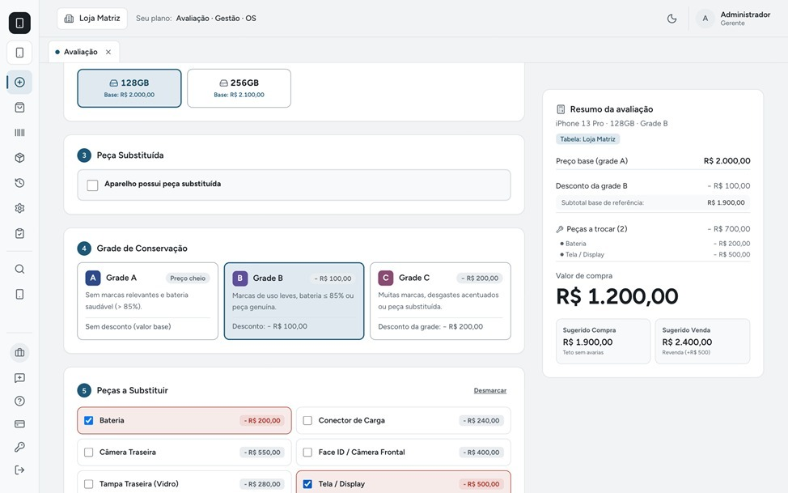

# Nexus Comercial — Landing Page Premium

Landing page profissional, moderna e de alta conversão para o **Nexus Comercial**, um SaaS de gestão voltado para lojas de eletrônicos, estabelecimentos que trabalham com compra e venda de aparelhos usados e assistências técnicas.



## 🚀 Tecnologias Utilizadas

- **React 19** com **TypeScript**
- **Vite 5**
- **Tailwind CSS 3**
- **Lucide React** (Ícones)

## 📌 Funcionalidades Apresentadas na Landing Page

- **Navbar Responsiva:** Navegação suave, link para planos e botão de acesso.
- **Hero Impactante:** Apresentação clara de valor e mockup do sistema.
- **Dores do Mercado:** Problemas comuns na gestão de eletrônicos (avaliação, estoque, financeiro).
- **A Solução:** Benefícios de centralizar a operação em uma plataforma única.
- **Avaliação Inteligente:** Demonstração do cálculo de compra por Grade A/B/C e abatimento de peças.
- **Estoque & IMEI:** Identificação individual de aparelhos e rastreamento.
- **Fluxo Operacional:** Etapas de ponta a ponta (Avaliação → Compra → Estoque → Venda → Financeiro + OS).
- **Interface Real:** Demonstração visual com telas reais do sistema.
- **Planos & Preços:** Apresentação clara das três modalidades comerciais (Funcionalidade, Gestão + OS, Completo).
- **FAQ:** Perguntas frequentes com sanfona (accordion).
- **CTA Final & Rodapé:** Chamada para conversão e estrutura institucional.

## 🛠️ Como Executar o Projeto Localmente

1. Clone o repositório:
```bash
git clone https://github.com/ToniKrls/NexusLadingPage.git
cd NexusLadingPage
```

2. Instale as dependências:
```bash
npm install
```

3. Inicie o servidor de desenvolvimento:
```bash
npm run dev
```

4. Para gerar o build de produção:
```bash
npm run build
```

---

Desenvolvido para o **Nexus Comercial**.
